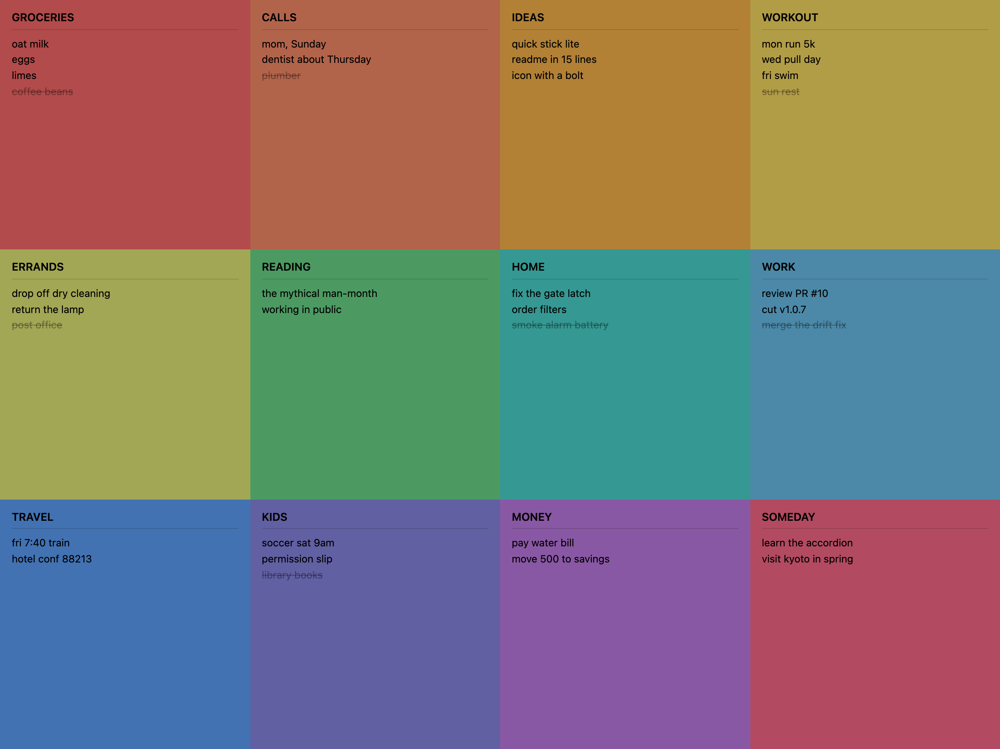

# Quick Stick Lite

A sticky-note grid in 1 file. No build, no framework, no dependencies, no fonts, no server.

- 12 cells in 4 columns, filling the screen. No settings.
- Each cell: an uppercase monospace title and a plain body. Enter in the title jumps to the body.
- Cmd+D / Ctrl+D strikes the caret's line (or every selected line) and moves it to the bottom. Same key on done lines undoes them.
- Everything is saved to localStorage on every keystroke.
- Made for iPad: add it to the Home Screen and it runs standalone, full screen and offline (a 4-line service worker caches the page).

Open `index.html` in a browser. That is the install. Open `index.html?demo` on an empty board for sample notes.

MIT.
